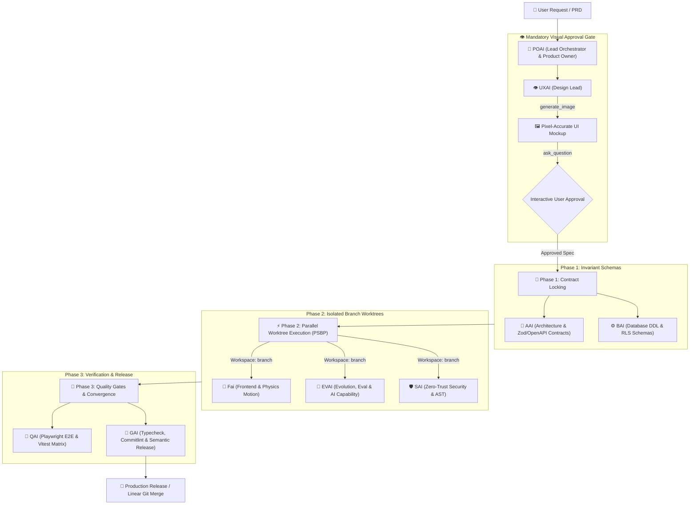
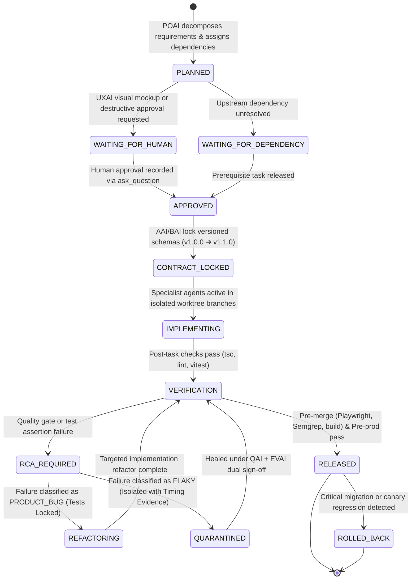
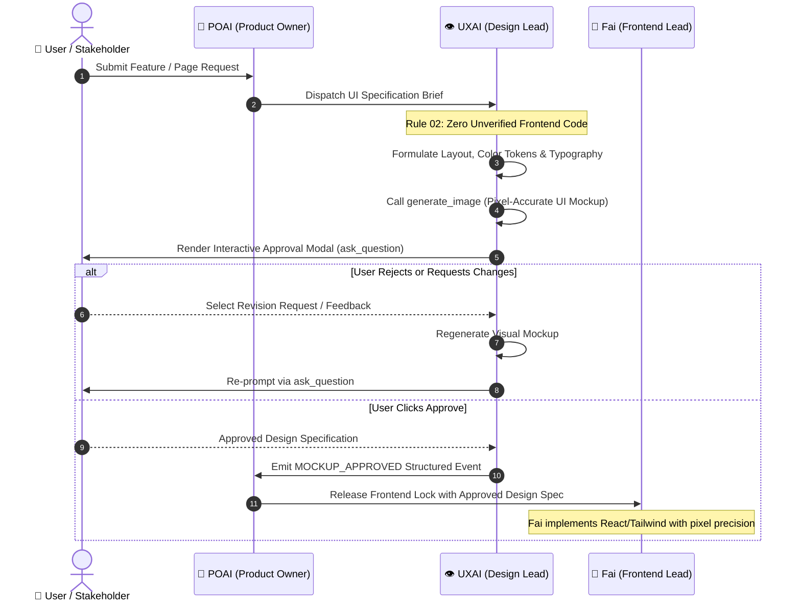
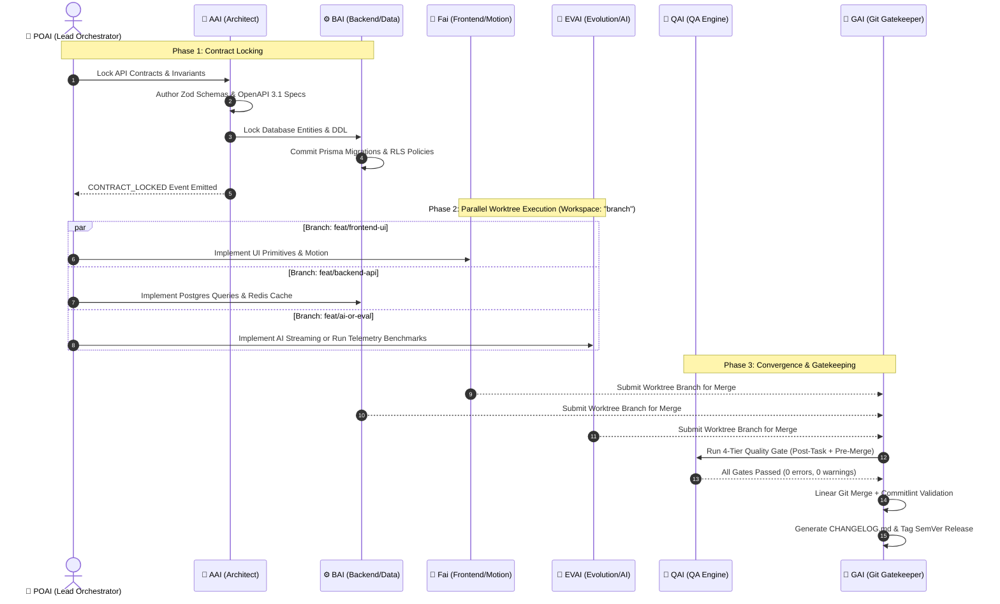
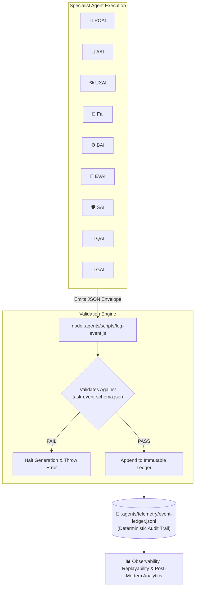
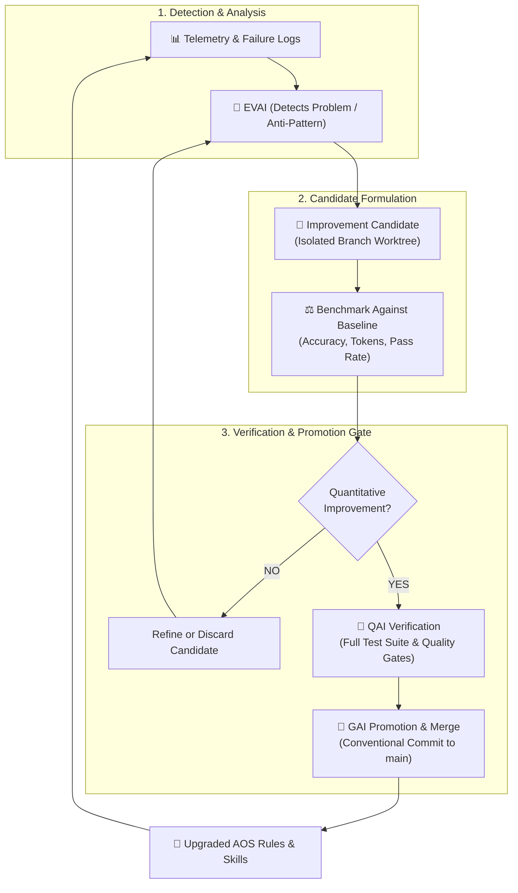
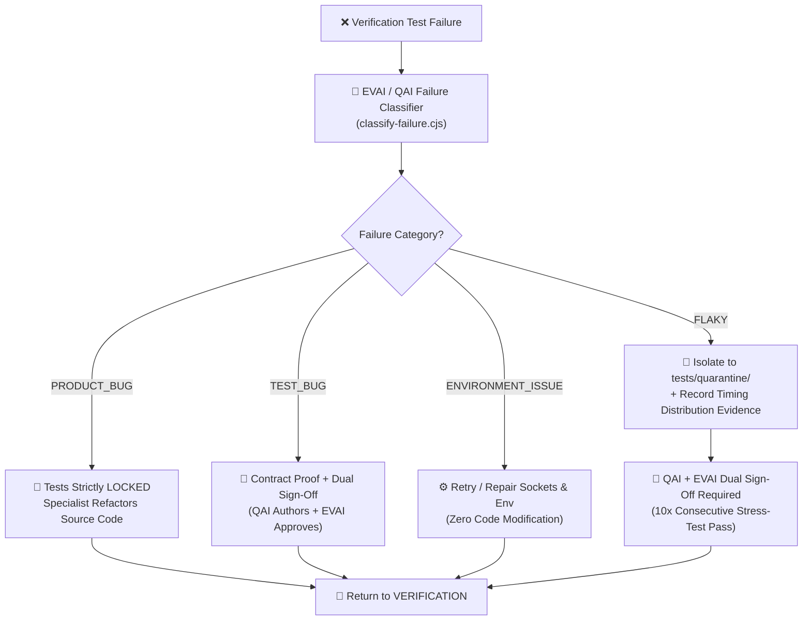
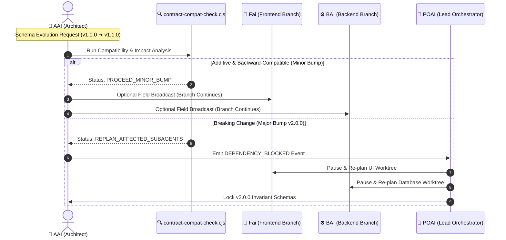
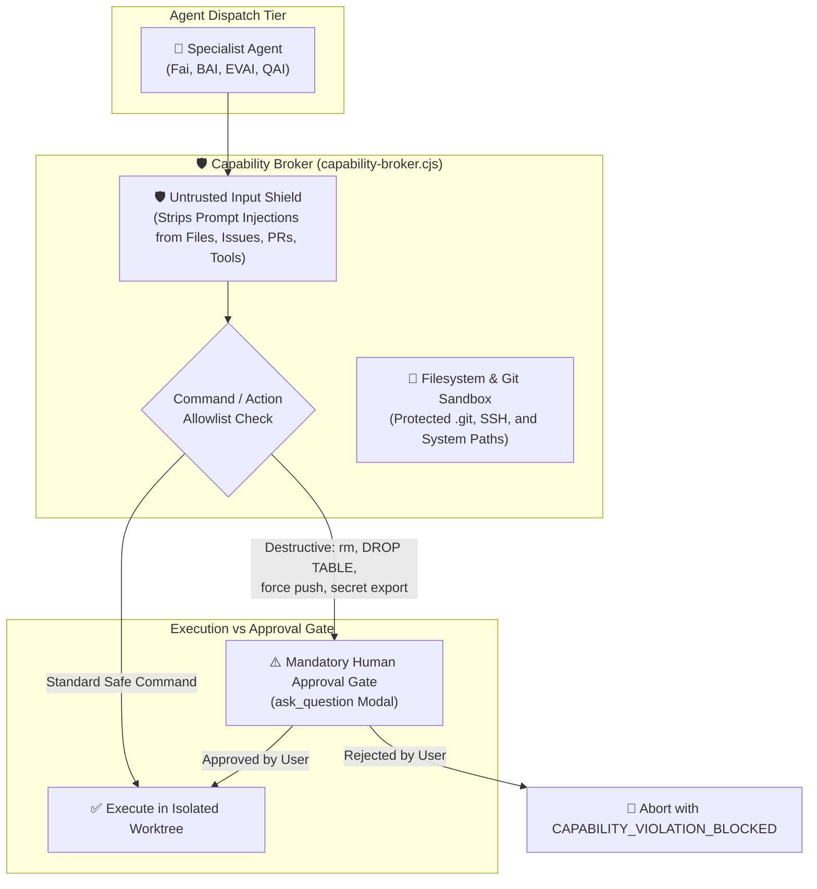

# 📐 ASP (Aegis Swarm Protocol) — Architecture & Workflow Diagrams

This document contains visual diagrams illustrating the multi-agent operating system, communication topology, reasoning checkpoints, explicit finite state machines, 4-tier quality gates, and parallel git execution protocol.

---

## 🧭 Diagram 1: Multi-Agent Swarm Topology & Orchestration

---

## 📡 Diagram 2: Operational 15-State Finite State Machine Protocol

---

## 🚦 Diagram 3: The 4-Tier Progressive Quality Gate Pipeline

```mermaid
flowchart LR
    subgraph Tier1["Tier 1: Pre-Edit Gate"]
        T1A["verify-path-isolation.js"]
        T1B["Fast Syntax & AST Check"]
    end

    subgraph Tier2["Tier 2: Post-Task Gate"]
        T2A["tsc --noEmit (Full Typecheck)"]
        T2B["ESLint Code Style Validation"]
        T2C["Vitest Isolated Unit Suite"]
    end

    subgraph Tier3["Tier 3: Pre-Merge Gate"]
        T3A["Integration Test Matrix"]
        T3B["Playwright Multi-Role E2E"]
        T3C["Semgrep Security AST Scan"]
        T3D["npm audit --audit-level=high"]
        T3E["npm run build (Bundle Verification)"]
    end

    subgraph Tier4["Tier 4: Pre-Production Gate"]
        T4A["Prisma DDL & RLS Status Check"]
        T4B["Critical Path Smoke Tests"]
        T4C["Rollback Compatibility Verification"]
    end

    Tier1 -->|Zero Per-File Lag| Tier2
    Tier2 -->|block_and_abort: Code 0| Tier3
    Tier3 -->|block_and_abort: Code 0| Tier4
    Tier4 -->|block_and_abort: Code 0| ReleaseReady["🚀 Production SemVer Release"]
```

---

## 🎨 Diagram 4: Mandatory UXAI Visual Mockup & Design Approval Flow

---

## ⚡ Diagram 5: Parallel Sub-Swarm Branching Protocol (PSBP)

---

## 📊 Diagram 6: Structured Telemetry & Event Ledger Bus

---

## 🧬 Diagram 7: Continuous Evolution & Benchmark Verification Loop

---

## 🔬 Diagram 8: Anti-Defect-Hiding Failure Classification Flow

---

## 📐 Diagram 9: Versioned Contract Evolution & Compatibility Graph

---

## 🛡️ Diagram 10: Agent Security Layer & Capability Broker Boundary

